# laser-gimbal

An original, fully 3D-printable **dual-axis (pan/tilt) gear-driven gimbal** that carries a **Raspberry Pi
Camera Module 3** and a **12 mm laser module** on one tilting head. Two NEMA17 steppers drive printed
herringbone gears (5:1 pan, 3:1 tilt). A Raspberry Pi 5 handles vision and a BTT SKR Pico handles
motion. All of the electronics live in a square bay under the round pan housing, and everything is modelled
in plain OpenSCAD with no external libraries.

The default laser is a **Class 2 (< 1 mW) red dot**. Read the laser safety section in
[ASSEMBLY.md](ASSEMBLY.md#laser-safety) before building.

## Renders

| Assembly (pan -20, tilt 15) | Side (tilt 45, beam stop fitted) | Exploded |
|---|---|---|
| 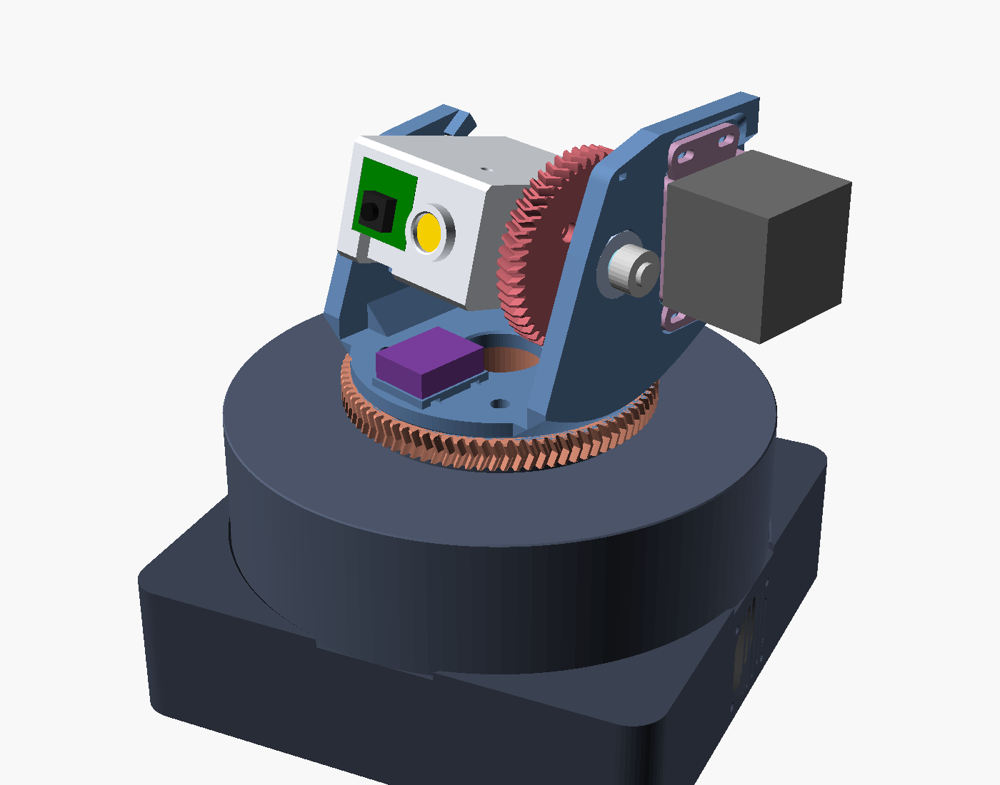 | 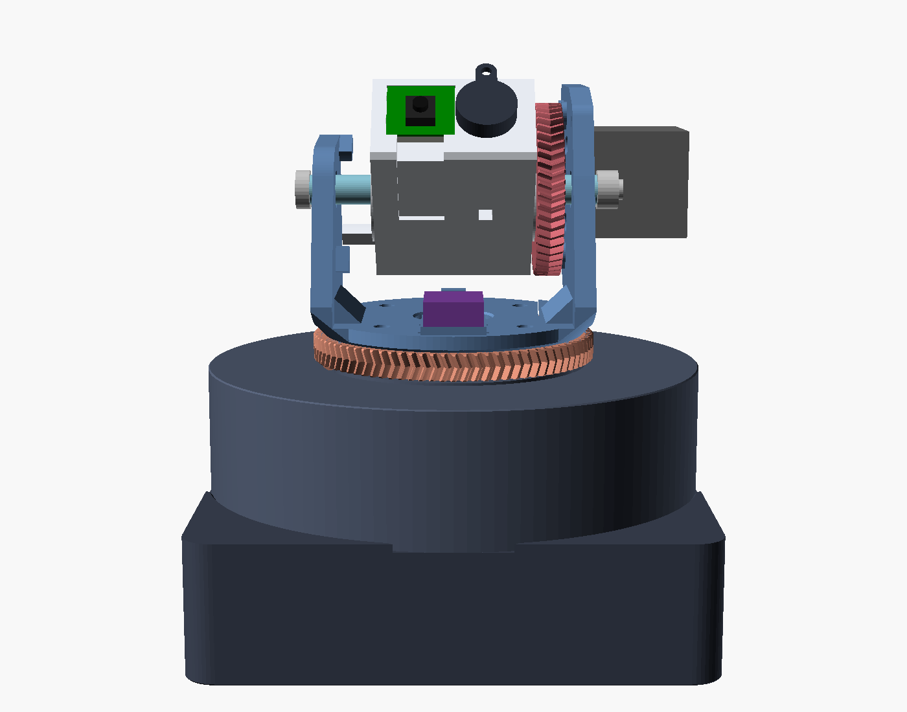 | 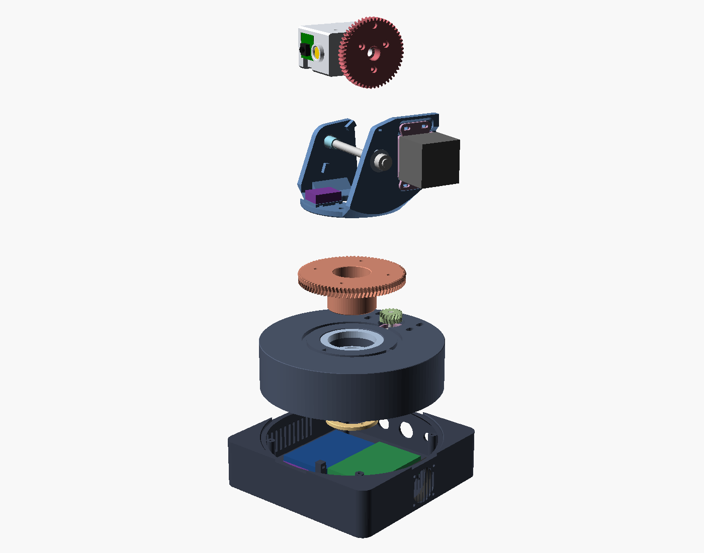 |

| Base | Bay | Yoke | Payload |
|---|---|---|---|
| 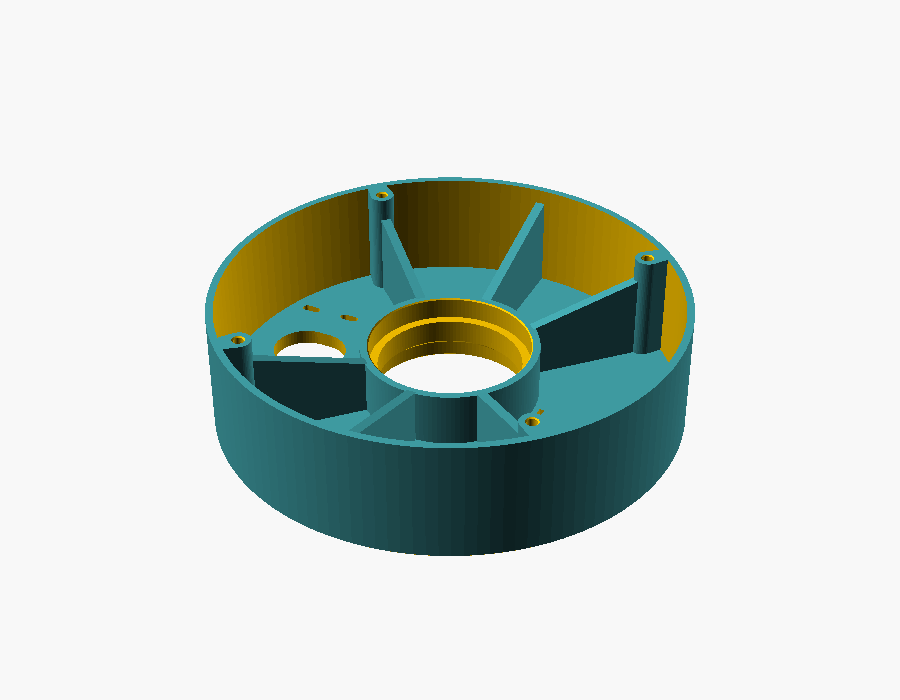 | 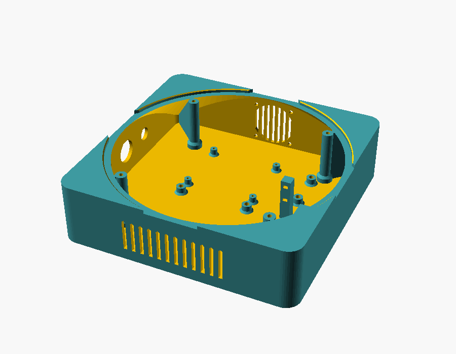 | 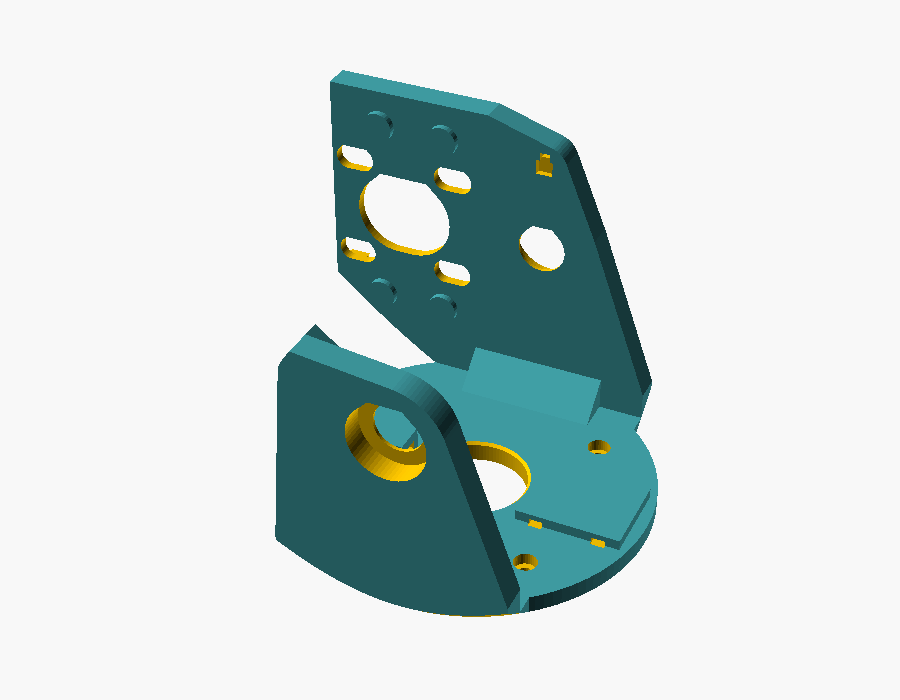 | 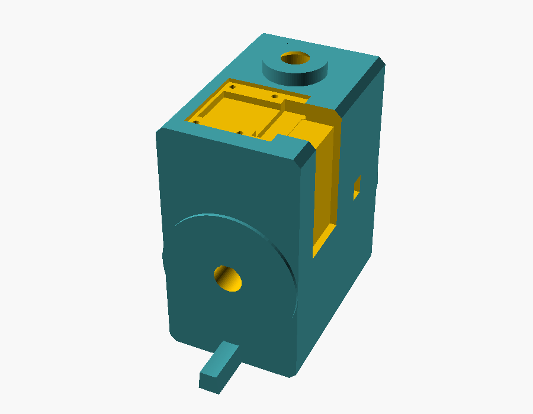 |

| Pinion | Pan motor plate | Tilt motor plate | Axle collar |
|---|---|---|---|
| 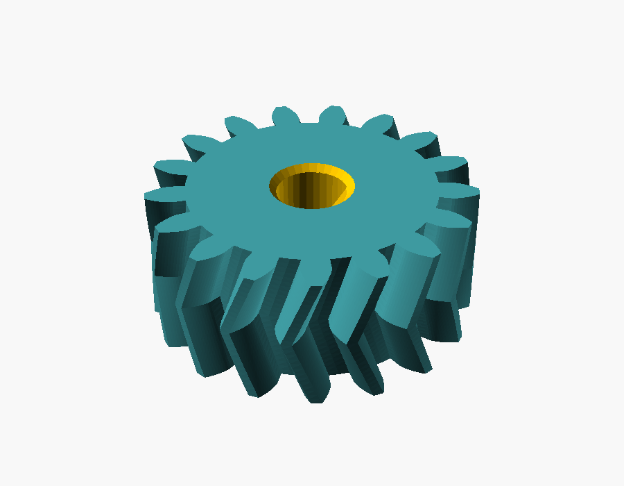 | 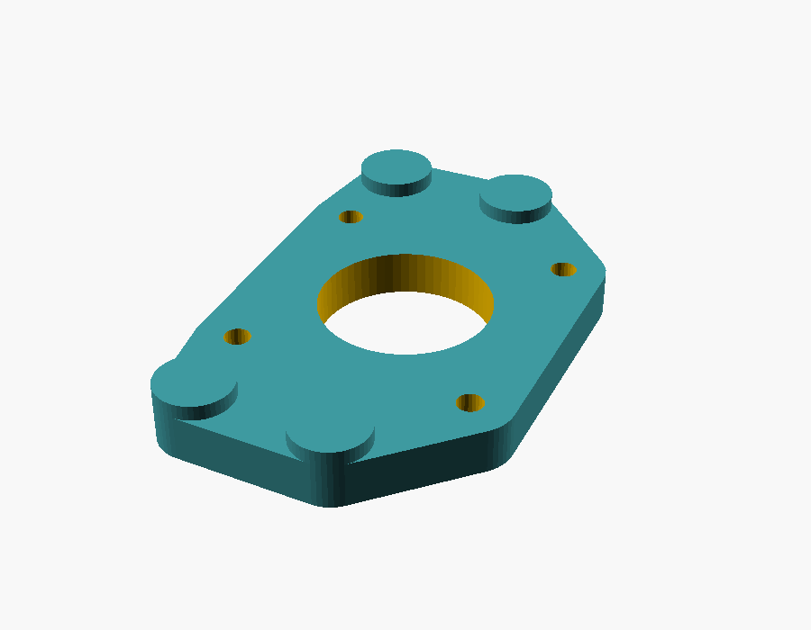 | 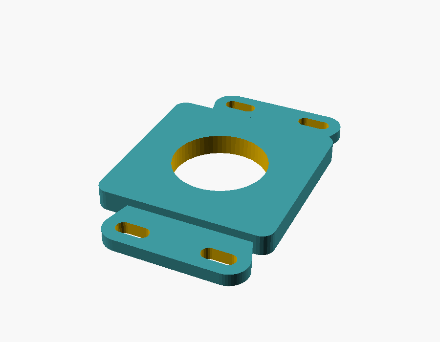 | 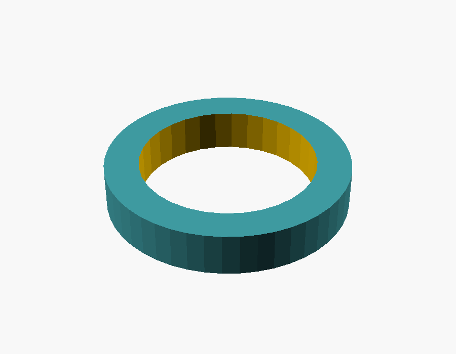 |

## Specifications

| | |
|---|---|
| Footprint | 190 x 190 mm (electronics bay); round 190 mm pan housing on top |
| Height | about 204 mm at tilt 0 (yoke arm top); the head reaches about 211 mm at tilt +90 |
| Swept envelope | the yoke and tilt motor sweep a circle of about 226 mm diameter above the base |
| Pan travel | +-175 deg hard stop (dog in a groove), +-170 deg recommended soft limit |
| Tilt travel | -20 to +90 deg (printed hard stops on the -Y arm) |
| Gearing | module 1.25, 20 deg PA, 20 deg herringbone, 10 mm face; 17T pinions; pan 17:85 = **5:1**, tilt 17:51 = **3:1** |
| Resolution | 1.8 deg motors at **16 microsteps**: pan 360 / (200 x 16 x 5) = **0.0225 deg/microstep** (0.36 deg/full step); tilt 360 / (200 x 16 x 3) = **0.0375 deg/microstep** (0.6 deg/full step) |
| Backlash | 0.15 mm per mesh by default (about 0.16 deg pan, 0.27 deg tilt at the wheel), tunable with `gear_test` and the motor-plate slots |
| Bearings | pan: 2x 6810-2RS back-to-back on the turntable spigot; tilt: 2x 608-2RS on a clamped M8 axle |
| Head | Camera Module 3 (connector edge down, image rotated 180 in software) and a 12 mm laser, 24 mm apart, both at tilt-axis height |
| Homing | A3144 hall sensors + 6x3 magnets on both axes (pan 0, tilt 0) |
| Cable path | 38 mm bore through the pan axis; the camera crosses it as a round HDMI cable (CSI-to-HDMI extender pair), not a twisted FFC |
| Electronics | Raspberry Pi 5, BTT SKR Pico (4x TMC2209), 12 V 5 A input, 12->5 V 5 A buck, laser TTL driver, 40 mm fan |
| Safety hardware | latching e-stop + key switch in the laser driver's **supply**, 5 A fuse, beam_stop cap |
| Printing | 14 STL files (16 machine pieces + 1 test coupon), about 650 g PLA/PETG, **no supports**, 250 x 250 bed |
| Cost | about $318 in parts ([BOM.md](BOM.md)) |

## Building the files

You need OpenSCAD 2021.01 (`/usr/bin/openscad`), GNU make and Python 3. CGAL is slow on the herringbones:
the turntable and tilt gear take a few minutes each.

```sh
make                      # every parts/<name>.scad -> stl/<name>.stl, then validates them all
make stl/yoke.stl         # one part
make check                # tools/check_stl.py on existing STLs: watertight, one body, on z = 0, fits the bed
make renders              # renders/assembly_front.png, assembly_side.png, exploded.png (OpenCSG preview)
make interference         # tools/interference.sh: pair/pose collision sweep, gear-mesh slices, hard stops, hex-key access
make viewer               # export the assembly for the browser viewer (viewer/meshes/)
make view                 # serve the viewer at http://localhost:8000
make clean                # delete stl/*.stl
```

Preview the machine at any pose with:

```sh
openscad -D pan=30 -D tilt=45 assembly.scad      # -D explode=1, -D show_vitamins=false, -D show_beam_stop=true
```

After changing `gear_backlash` (see the gear test in [ASSEMBLY.md](ASSEMBLY.md)), run `make` again: every STL
depends on `lib/`.

## Browser viewer

`viewer/` is an interactive 3D model of the machine built only from the exported meshes. `make viewer`
exports every object from `assembly.scad` in its assembled position (pan 0, tilt 0) plus the pivot points
and gear ratios from `lib/params.scad`; the viewer adds nothing but the motion. `make view` serves it.

- Drive pan and tilt; both pinions turn at their real ratios, with motor shaft angles and 1/16 microsteps.
- A live check shows any part touching another at the current pose.
- **Run checks** tests the exact triangles: the full range (pan +-174.5 x tilt -19.5..89.5 deg, 5 deg steps,
  every pair of parts on different moving bodies), both gear meshes over 3 tooth pitches at 1/24-pitch steps,
  the hard stops 1 deg past each limit (must collide), and a sanity run with the pinions reversed (must
  clash). Touching faces count as contact, not a hit. Current result: 6/6 pass, about 25 s in a browser.
- The laser beam is cast into a room with a target board 3 m away; the camera inset shows what a Camera
  Module 3 (66 x 41 deg) sees, upright, with the dot's pixel position on the 4608 x 2592 sensor.

The page loads three.js 0.160.0 and three-mesh-bvh 0.7.6 from jsDelivr. It uses its own triangle test:
three-mesh-bvh's reports false hits when a vertex lies exactly on the other triangle's plane (the pinion and
wheel end faces share y = 41).

## File map

```
lib/params.scad        interface contract: world frame, Z stack, every shared dimension, wiring notes
lib/gears.scad         involute gear2d(), herringbone(), mesh_phase() (no external libraries)
lib/vitamins.scad      purchased-part placeholders for assembly/interference only (never printed)
parts/base.scad        pan housing: 6810 hub, motor-plate slots, pan stop groove, pan hall pocket
parts/bay.scad         electronics tray: standoffs, panel (e-stop / key / jack), fan, vents, cable anchor
parts/turntable.scad   85T herringbone + bearing spigot, deck inserts, pan magnet, pan stop dog
parts/pan_collar.scad  ring clamping the lower 6810 inner race
parts/pan_motor_plate.scad  pan NEMA17 carrier, X-slotted for mesh/backlash
parts/pinion.scad      17T hubless herringbone pinion (print 2)
parts/yoke.scad        deck + arms: 608 pockets, tilt motor pocket, tilt stops, tilt hall, cable anchor
parts/tilt_motor_plate.scad tilt NEMA17 carrier, X-slotted
parts/tilt_gear.scad   51T herringbone tilt wheel with tilt magnet
parts/tilt_spacer.scad axle spacer tube (print 2)
parts/axle_collar.scad M8 head/nut collar (print 2)
parts/payload.scad     tilting head: camera recess, laser bore + clamp, stop lug, axle bore
parts/beam_stop.scad   opaque push-fit cap for the laser exit collar
parts/gear_test.scad   backlash test coupon (print first)
assembly.scad          full machine at any pan/tilt, exploded view
tools/check_stl.py     STL validator used by make
tools/interference.sh  collision / mesh / hard-stop / tool-access checks
tools/viewer_objs.scad assembly objects + kinematics for the viewer (world coordinates, pan 0 / tilt 0)
tools/export_viewer.sh make viewer: OpenSCAD export -> binary STL (tools/stl2bin.py) + kinematics.json
viewer/index.html      browser viewer        viewer/sim.js   rig motion + collision checks
stl/                   generated STLs        renders/   generated PNGs
tmp/                   scratch fit checks (gitignored)
BOM.csv, BOM.md        bill of materials and cost / filament estimate
ASSEMBLY.md            print settings, inserts, gear test, assembly order, wiring, homing, laser safety
```

Every part module is authored in world coordinates at pan = 0 and tilt = 0, and `<name>_print()` places it in
its print orientation on z = 0. Each part file's only top-level statement is `<name>_print();`.

## Status

All 14 STLs pass `make check`, `make interference` reports no collisions, and the browser viewer's checks
pass 6/6. Nothing has been printed yet:
measure your bearings, motors, camera and boards against `lib/params.scad`, and print `gear_test` first
to tune `gear_backlash`.

## Credits

This is an original design, inspired by the general concept of a dual-axis stepper laser gimbal. No
third-party files, models or libraries were used. All geometry is written from scratch in this repository.
